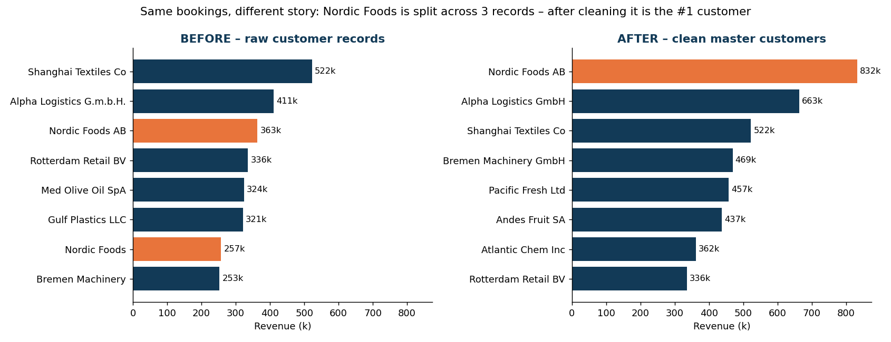
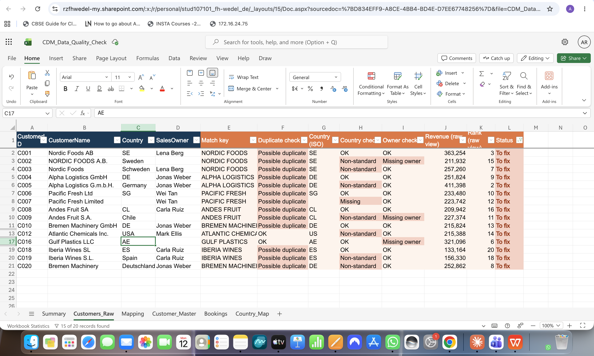
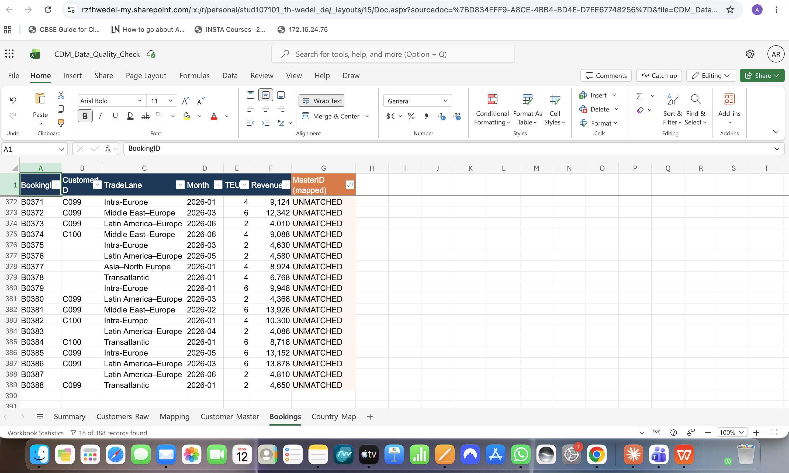

# Customer Data Quality Check – a repeatable monthly routine

A small **Customer Data Management (CDM)** project: a check you can run every month in about 15 minutes. It finds duplicate customers, missing owners, non-standard countries and unmatched bookings, and shows why they matter for sales.
*(Practice data, created by me. No real company data.)*

## The idea
Clean customer data isn't a one-time dashboard. It's a **routine**. New customers are created every week, so new mistakes come in every week. This workbook turns the check into a few repeatable steps: paste the new data, let the formulas flag the problems, send a to-fix list.

## The monthly routine (`CDM_Data_Quality_Check.xlsx`)
1. Paste the new customer export into **Customers_Raw** (columns A–D).
2. Paste the new bookings into **Bookings** (columns A–F).
3. Add any new customer IDs to **Mapping**.
4. Filter **Customers_Raw › Status = "To fix"**.
5. Send the list to the responsible sales owners.
6. Note the KPIs on **Summary**, to follow the trend month by month.

**To-fix list after filtering (15 of 20 records):**

**Bookings with no matching customer (18 of 388):**

The orange columns are formulas, so nothing has to be checked by hand:

| Check | How |
|---|---|
| Possible duplicate | A "match key" (name in capitals, without dots or the legal form) → `COUNTIF` > 1 |
| Country | Typed value looked up in **Country_Map** → flagged if it isn't the ISO code or is missing |
| Sales owner | Flagged if empty |
| Booking → customer | `INDEX/MATCH` to Mapping → `UNMATCHED` if there's no master record |
| Totals check | Clean view + unmatched = total revenue → "OK – totals match" |

## What this month's check found

| Data quality | Result |
|---|---|
| Customer records vs real customers | **20 records, 12 customers → 8 duplicates (40%)** |
| Caught by the match-key rule | 7 of 8 duplicates. *"Atlantic Chem" vs "Atlantic Chemicals" needs a human*, because rules help but don't replace judgement |
| Country missing or non-standard | **8 records** (DE / Germany / Deutschland …) |
| Sales owner missing | **3 records** |
| Unmatched bookings | **18 bookings · 2.8% of revenue** |

## Why it matters for sales

| | Raw records | Clean master |
|---|---|---|
| #1 customer | Shanghai Textiles Co (522k) | **Nordic Foods AB (832k)** |
| Nordic Foods | Split into 3 records: rank **#3, #7 and #15** | One customer, **#1** |
| Top-4 customers' share of revenue | 31% | **47%** |

**Insight:** messy data hid the biggest customer. Sales could under-serve their #1 account without knowing it.

## Same logic in Qlik Sense
[`load_script.qvs`](load_script.qvs) does the same mapping in Qlik with `ApplyMap()`, so reports group bookings by the clean master customer automatically, with an `UNMATCHED` bucket so no revenue silently disappears.

## What I'd suggest in a real team
- Agree on **one customer master** (for example, the CRM) and map every other system to it.
- **Use dropdowns, not free text** for country and owner, so the problem is stopped at entry.
- Keep the monthly check and **track the duplicate rate and unmatched %** over time. If they go down, the process is working.

## Files
`CDM_Data_Quality_Check.xlsx` · `load_script.qvs` · `data/` (4 CSVs) · `images/before_after.png`
